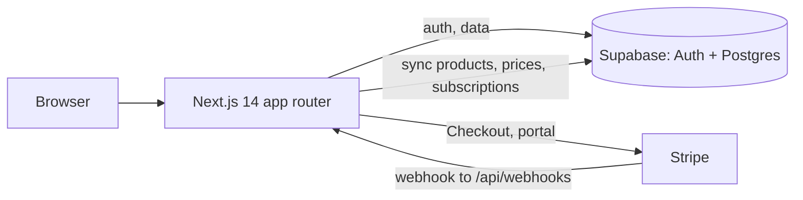

# mycto.app2

A Next.js, Supabase and Stripe subscription-payments app, still the unmodified Vercel starter, with no mycto.app2 product code yet.

> [!NOTE]
> Status: started 2024-06-29 as a one-commit copy of Vercel's "Next.js Subscription Payments Starter" (the GitHub "Initial commit", sha `58c1314`). Nothing was changed from the starter except the repo name. Not deployed, installed, built or run in this audit. The on-page title is still "Next.js Subscription Starter".

## What it does

The code in this repo is the stock starter. Today it provides:

- Sign in and sign up with Supabase Auth (email magic link, email and password, and GitHub OAuth), routes `/signin`, `/signin/[id]`, `/auth/callback` and `/auth/reset_password`.
- A pricing page at `/` that lists Stripe products and prices synced into Postgres, with Stripe Checkout to subscribe.
- An `/account` page for the signed-in user, with the Stripe customer portal link.
- A Stripe webhook endpoint at `/api/webhooks` that keeps products, prices, customers and subscriptions in Supabase in sync.

The idea behind the name is a guess: a paid MyCTO app **(inference)**. No code in the repo says so.

## How it works

Next.js 14.2 (app router), React 18, TypeScript, Tailwind CSS with shadcn-style components in `components/ui`, `@supabase/ssr`, and the `stripe` SDK. The database schema is in `supabase/migrations/20230530034630_init.sql` (also `schema.sql`); generated types are in `types_db.ts`. `middleware.ts` refreshes the Supabase session.

## Getting started

Prerequisites: Node.js, pnpm (the lockfile is `pnpm-lock.yaml`), a Supabase project or the Supabase CLI for local development, a Stripe account and the Stripe CLI.

1. Install: `pnpm install`
2. Copy `.env.local.example` to `.env.local` and fill in these variables (names only; never commit values):
   - `NEXT_PUBLIC_SITE_URL`
   - `NEXT_PUBLIC_SUPABASE_URL`, `NEXT_PUBLIC_SUPABASE_ANON_KEY`, `SUPABASE_SERVICE_ROLE_KEY`
   - `NEXT_PUBLIC_STRIPE_PUBLISHABLE_KEY`, `STRIPE_SECRET_KEY`, `STRIPE_WEBHOOK_SECRET`
3. For GitHub sign-in with local Supabase, copy `.env.example` to `.env` and set `SUPABASE_AUTH_EXTERNAL_GITHUB_CLIENT_ID`, `SUPABASE_AUTH_EXTERNAL_GITHUB_SECRET` and `SUPABASE_AUTH_EXTERNAL_GITHUB_REDIRECT_URI`.
4. Local Supabase: `pnpm supabase:start`, then `pnpm supabase:reset` to apply migrations and seed.
5. Stripe: `pnpm stripe:login`, `pnpm stripe:listen` (forwards webhooks to `localhost:3000/api/webhooks`), and `pnpm stripe:fixtures` to create sample products.
6. Run: `pnpm dev` (Next.js with Turbopack) and open http://localhost:3000.

Other scripts from `package.json`: `build`, `start`, `lint`, `prettier-fix`, and `supabase:*` helpers (`stop`, `status`, `restart`, `link`, `push`, `pull`, `generate-types`, `generate-migration`, `generate-seed`).

The original upstream setup guide (Vercel deploy button, Supabase and Stripe dashboard steps, customer portal) is in the upstream repo: https://github.com/vercel/nextjs-subscription-payments

## Project history

- 2024-06-29: "Initial commit", the only commit, made by Vercel's new-project flow (commit body: "Created from https://vercel.com/new"), so a Vercel project was linked at creation. The same tree was created as three sibling repos within three days (`grooveroom.club`, `walletbot.dev`, `mycto.app2`); their file contents are byte-identical.

See [docs/STATUS.md](docs/STATUS.md) for current state.

## License

MIT, copyright 2024 Vercel, Inc., from the upstream starter (see `LICENSE`). `package.json` has no `license` field.
